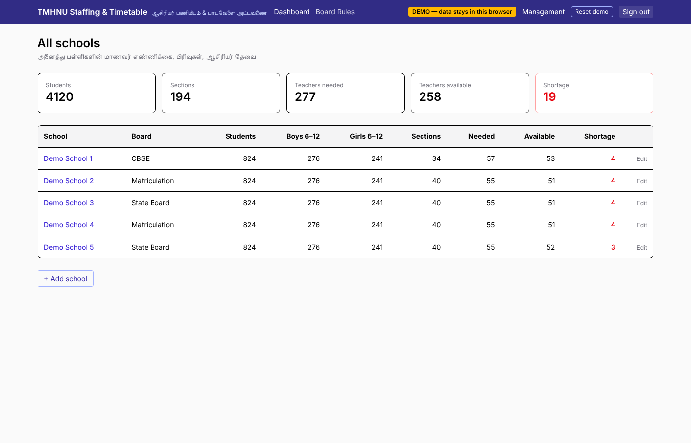
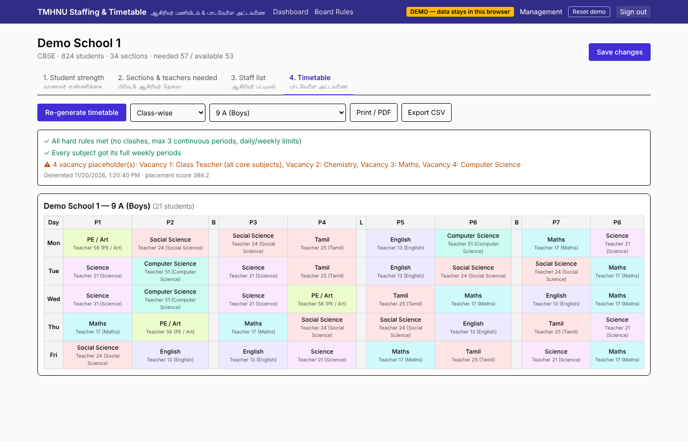

# TMHNU Staffing & Timetable

**Live demo:** https://vigneshls.github.io/tmhnu-staffing/ (demo mode: fictional data, stored only in your browser)

A web app for managing teacher requirements and timetables across 5 schools: CBSE, Matriculation and State Board, from Pre-KG to Class 12.
ஆசிரியர் தேவை கணக்கீடு & பாடவேளை அட்டவணை.



## What it does

1. **Student strength:** enter a total for Pre-KG to Class 5, and boys/girls separately from Class 6. Classes 11–12 are entered per group (Maths-Bio, Maths-CS, Commerce…).
2. **Sections:** calculated automatically from each board's section cap. Boys and girls can get separate sections from Class 6.
3. **Teachers needed, subject-wise:** each section's subject goes to one teacher, packed up to the planning load. Pre-primary and Classes 1–5 get one class teacher per section. The app shows the shortage or surplus against the actual staff list.
4. **Compliance checks:** section-size cap, pupil–teacher ratio, and the CBSE rule of 1.5 teachers per section.
5. **Timetable generator:** produces class-wise and teacher-wise timetables. Hard rules are never broken: no clashes, weekly and daily limits, and at most 3 continuous periods. It also places difficult subjects in the first 3 periods, languages and activities after lunch, and Library/Club in the last period. Missing teachers appear as **Vacancy** placeholders, so the full timetable is always visible.
6. **Board rules:** management can edit them without touching code (day structure, caps, workload, subject periods).
7. **Roles:** Management sees all schools and edits rules. A Principal sees only their own school, and this is enforced in the database by Row Level Security.
8. **Export:** CSV export, and print/PDF.



## Default rules and where they come from

| Value | Default | Source |
|---|---|---|
| Workload ranges (Montessori 25–30, SGT 30–35, TGT 32–36, PGT 30–32, Academic Head 15–20) | TMHNU policy | TMHNU Staff Workload Policy |
| Max 3 continuous periods; 5 working days; 2 short intervals | | TN norms document (management) |
| Classes 6–8 subject periods (38) | + Computer Science 2 to fill 40 slots | TN document; CS added (sample) |
| TN PTR: Primary 1:30, Middle 1:35, High 1:40, HSS 1:60 | | TN School Education Dept (2019 revision) |
| CBSE: 40 students per section; 1.5 teachers per section; PTR 30:1 | | CBSE Affiliation Bye-Laws 2018, cl. 4.8 and 5.4 |
| All other subject allocations, State/Matric section caps | **sample: confirm with each school** | none |

**Known conflict in the source documents:** with 8 periods a day, lunch after period 4 and the 3-continuous-period rule, a teacher can take at most 6 periods a day (30 a week). TMHNU's TGT range of 32–36 therefore can't be scheduled. The app uses the schedulable limit and shows a warning. To change this, go to Board Rules and either tick *Short intervals also break the continuous count* or change the day structure. The full requirements are in [docs/REQUIREMENTS.md](docs/REQUIREMENTS.md).

## Run locally

```bash
npm ci
npm run dev        # http://localhost:5173
npm test           # engine tests
npm run build
```

## Go live with real logins (Supabase, free tier)

1. Create a project at supabase.com, then run [`supabase/schema.sql`](supabase/schema.sql) in the SQL Editor.
2. Go to Authentication → Users and add the management user and the 5 principals (email and password).
3. Insert the 5 schools and link each user in `profiles`. The commented SQL at the end of `schema.sql` shows how.
4. In GitHub, go to Repo → Settings → Secrets and variables → Actions → **Variables**, and add `VITE_SUPABASE_URL` and `VITE_SUPABASE_ANON_KEY`. Then re-run the deploy workflow.

| Env variable | Where to find it | Secret? |
|---|---|---|
| `VITE_SUPABASE_URL` | Supabase → Project Settings → API | No |
| `VITE_SUPABASE_ANON_KEY` | Supabase → Project Settings → API (anon/public) | No. It is public by design, and RLS protects the data. **Never** use the `service_role` key here. |

Supabase free-tier projects pause after a period of inactivity. Check Supabase's current terms.

## Deploy to GitHub Pages

```bash
git push origin main
# then once: Repo → Settings → Pages → Source: GitHub Actions
```
The workflow at `.github/workflows/deploy.yml` tests, builds and publishes the site on every push to `main`.

## Data privacy

The app stores staff names and student counts only, and no individual student records. Access is limited by role. Treat staff data as personal data under India's DPDP Act 2023.

## Stack

React 19 + TypeScript + Vite, Tailwind CSS, Supabase (Postgres + Auth + RLS), Vitest. The timetable engine is in `src/engine/` and has no UI dependencies.

## License

MIT
